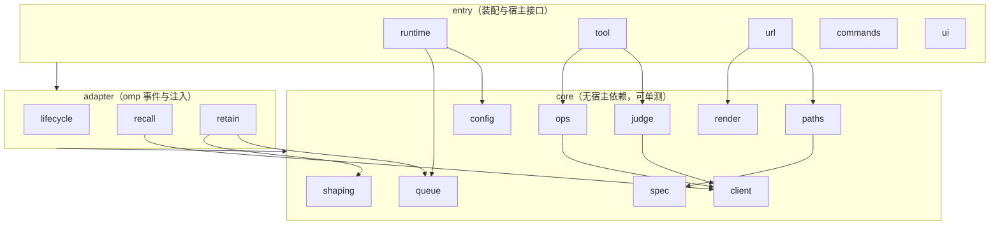
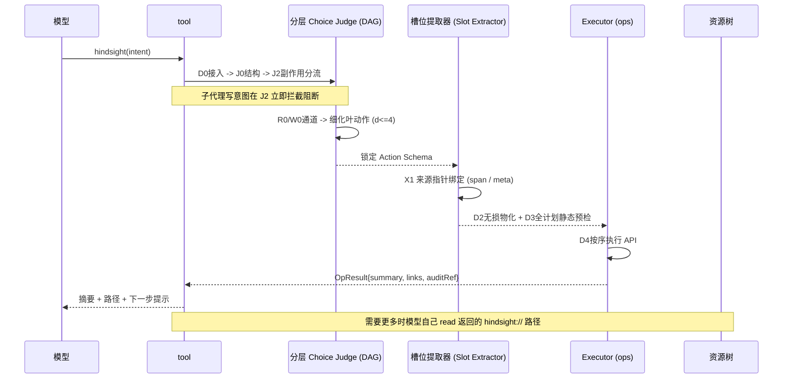
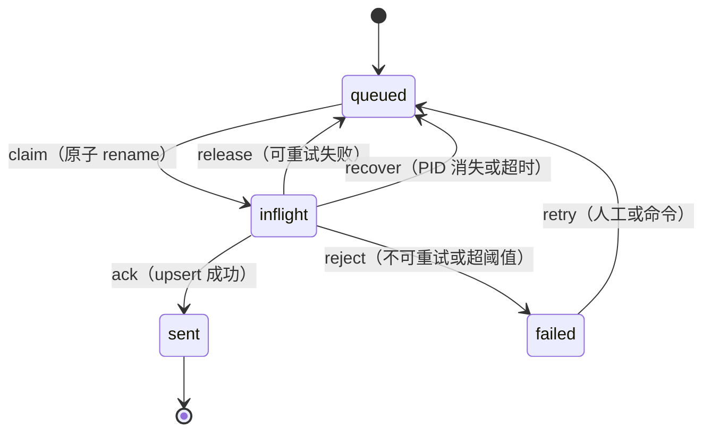
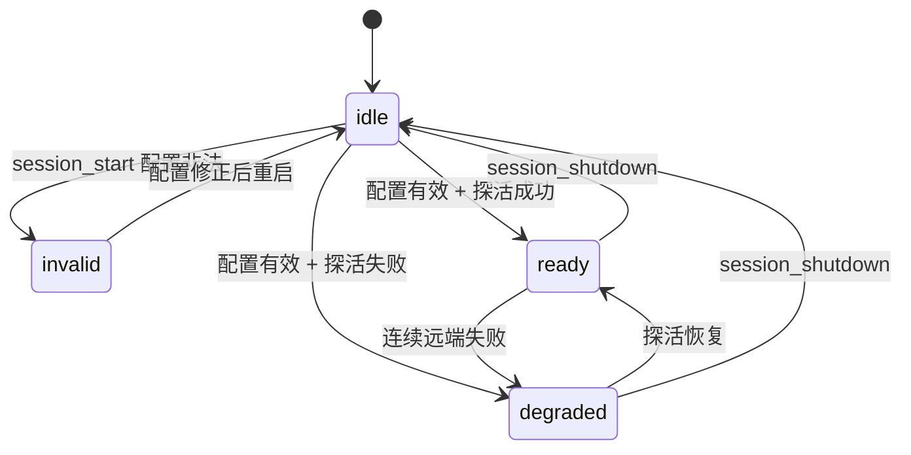

# hindsight-omp 架构设计

> 2026-11-01。上游文档：`DESIGN.md`（定位、资源面、操作面）、`RUNTIME.md`（运行时行为）、`ssot/spec.ts`（全部常量的唯一来源）。本文回答"代码长什么样"：模块边界、接口契约、数据流、状态机、装配顺序。
>
> 本文不复述 SSOT 里的取值。凡是操作集合、路由、配置键、队列状态，一律引用 `spec.ts` 的切片名。
>
> **文档重构导读**：
> 架构模块、判定拓扑与运行时契约已全面展开：
> - 插件总览与快速导航：[README.md](README.md)
> - 判定网络架构与拓扑：[docs/02-judge-system/01-routing-topology.md](docs/02-judge-system/01-routing-topology.md)
> - 判定节点完整手册：[docs/02-judge-system/02-choice-nodes.md](docs/02-judge-system/02-choice-nodes.md)
> - 两阶段参数物化与无损装配：[docs/02-judge-system/03-two-stage-slots.md](docs/02-judge-system/03-two-stage-slots.md)
> - 上下文严格隔离矩阵：[docs/02-judge-system/04-context-isolation.md](docs/02-judge-system/04-context-isolation.md)

## 1. 装配模型

一个进程一份运行时，由配置驱动：`session_start`（仅主会话）读取配置并装配，配置变化时整体重启，`session_shutdown` 释放。这与 onlyne 的 `runtime.ts` 同构，理由是配置驱动的单例让"配置非法则插件静止"成为一句话而不是散落在各模块的判断。

生命周期状态只有四个：

```ts
type RuntimeState =
  | { kind: "idle" }                                        // 未装配（子会话，或尚无配置）
  | { kind: "ready"; rt: Runtime }                          // 装配完成，可服务
  | { kind: "invalid"; problems: readonly ConfigProblem[] } // 配置非法，静止但可见
  | { kind: "degraded"; rt: Runtime; problem: string }      // 服务不可达，队列与资源树仍在
```

`invalid` 与 `degraded` 的区别是刻意的：前者不注册工具与路由（`INV-10` 的失败面），后者照常注册，只是所有远端调用走 `FAILURE_MODES` 的第一行。

## 2. 模块图



依赖只允许沿 `entry → adapter → core` 方向（`INV-9`）。`core` 不允许 import 任何 `@oh-my-pi/pi-coding-agent` 的类型，这是让核心逻辑可在无宿主环境下测试的分界线。

## 3. 接口契约

### 3.1 配置

```ts
interface ConfigProblem { readonly key: string; readonly reason: string }

interface Config {
  readonly baseUrl: string;
  readonly apiKey: string | null;          // 从 apiKeyEnvVar 解析，永不出现在日志
  readonly banks: readonly BankConfig[];   // 键形态由 CONFIG_KEYS 的 banks[].* 约束
  readonly shaping: ShapingConfig;
  readonly behavior: BehaviorConfig;
}

function loadConfig(cwd: string, role: string | null): { ok: true; config: Config } | { ok: false; problems: readonly ConfigProblem[] };
```

`role` 用于展开 `banks[].bankId` 里的 `${ROLE}`；展开失败时该 bank 停用并产生一条 problem，其余 bank 不受影响。

### 3.2 资源树

```ts
interface RouteMatch {
  readonly route: PathRoute;
  readonly params: Readonly<Record<string, string>>;  // 已 decodeURIComponent
}

function matchRoute(pathname: string): RouteMatch | null;                  // 用 rawPathname 匹配
function renderRoute(rt: Runtime, m: RouteMatch, ctx: RenderContext): Promise<Rendered>;

interface Rendered {
  readonly content: string;
  readonly contentType: "text/markdown";
  readonly immutable: boolean;
}
```

`RenderContext` 含可分页游标、当前会话是否为子代理（决定 `scope: "main"` 的路由是否可见）、以及 `pathMapping` 的解析结果。

### 3.3 客户端

```ts
interface HindsightClient {
  get<T>(path: string, signal?: AbortSignal): Promise<T>;
  post<T>(path: string, body: unknown, opts?: { signal?: AbortSignal; timeoutMs?: number }): Promise<T>;
  // 只覆盖 OPERATIONS 实际用到的端点；不实现完整 SDK
}

function createClient(config: Config): HindsightClient;
```

鉴权在 `createClient` 内一次装配；`apiKey` 为空时不发 Authorization 头（自托管无鉴权场景）。超时按调用区分：检索类用 `recallTimeoutMs`，写入类用服务端推荐的异步语义（提交即返回 operation id）。

### 3.4 分层 Judge 与槽位提取（详见 docs/judge/）

单次大选择题（11+ 分支）已被证实会导致判定抖动、语义边界不清。本插件采用**分层决策 DAG + 无损槽位提取**架构（规范详见 `docs/judge/`）：

1. **低分支度定性路由（Choice）**：每题至多 3 个普通候选 + 1 个 `unresolved`（严格满足 $2 \le d(n) \le 4$）。走 `modelRoles.judge`（`resolveJudge`），按"请求结构（J0）→ 副作用（J2: read/write）→ 信息通道（R0/W0）→ 动作形态（RA/RB/WA/WB）"分层下钻，逐级收敛至确定的叶动作 Schema（共 50 个细粒度叶动作）。
2. **无损参数绑定（Slot Extraction）**：禁止模型凭空重写或生成业务文本。通过结构化提取端口（X0/X1，绑定当前 session model 输出 JSON Schema）仅提取对原始输入文本的切片指针（`span`）、元数据指针（`meta`）、受控枚举或前序动作的结果依赖指针。由确定性代码从原始材料中无损物化参数。
3. **严格上下文隔离**：每个决策节点只能看到其决策所需的投影字段（`ContextView`），对下游数据结构严格盲目。

```ts
interface ResolutionOutcome {
  readonly status: "resolved" | "needs_clarification" | "unsupported" | "denied" | "decision_unavailable";
  readonly plan?: PreparedPlan;
  readonly clarification?: ClarificationQuestion;
  readonly auditTrail: readonly JudgeAuditEvent[];
}

async function resolveIntent(rt: Runtime, raw: RawIntent, signal?: AbortSignal): Promise<ResolutionOutcome>;
```

实现纪律（`RUNTIME.md` §2、`docs/judge/`、`INVARIANTS` INV-4）：

- 严格每题分支度 $d \le 4$；`unresolved` 表达证据不足或不支持，直接阻断，不设"其他"分支继续猜。
- 子代理写阻断在副作用分流（J2）和动作特化前即刻触发，彻底切断写路径。
- 判定结果、反问及未决状态整条落到 `hindsight://plugin/operations/{seq}`，支持离线确定性重放。
- 复合意图（多动作）先完成全计划静态校验，再串行执行。

### 3.5 操作执行

```ts
interface OpResult {
  readonly summary: string;                    // 一句人话
  readonly links: readonly string[];           // 按 OPERATIONS[id].returns 生成的路径
  readonly details?: unknown;                  // 结构化数据，供 UI 渲染
}

async function executeOperation(rt: Runtime, j: Judgment, ctx: OpContext): Promise<OpResult>;
```

写操作的准入检查集中在 `executeOperation` 一处：`OPERATIONS[id].write` → 子代理拒绝（INV-6）→ bank 的 `retain.mode` 允许（INV-3）→ 审批。三条检查任一条不过即返回可读拒绝理由，不抛错。

### 3.6 队列

```ts
interface QueueEntry {
  readonly id: string;
  readonly kind: QueueKind;          // pending | tool
  readonly sessionId: string;
  readonly state: QueueState;
  readonly attempts: number;
  readonly lastError?: string;
  readonly payload?: unknown;        // 仅 kind === "tool" 携带内容
}

interface Queue {
  enqueue(entry: Omit<QueueEntry, "state" | "attempts">): Promise<void>;
  claim(sessionId: string): Promise<Claim | null>;     // 原子 rename
  settle(claim: Claim, outcome: "sent" | "failed" | "release", detail?: string): Promise<void>;
  recover(): Promise<number>;                          // 返回恢复条数
  snapshot(): Promise<readonly QueueEntry[]>;          // 供资源树渲染
}
```

## 4. 数据流

### 4.1 资源树读取

1. omp 的 `read` 命中 `hindsight://…`，路由到 handler，传入原始 pathname。
2. `matchRoute` 按 `PATH_ROUTES` 从具体到宽松匹配；`{doc}` 这类含斜杠的 id 已在 path 里整体编码，此处仅解码。
3. 需要远端的路由调 `client.get`，端点来自 `route.endpoint`；纯本地路由（`queue`、`plugin/*`）直接读运行时状态。
4. `renderRoute` 生成 markdown：列表带分页游标，叶带元数据、正文、以及交叉链接（事实叶指向文档与 chunk，文档叶指向本地 bundle 路径）。
5. 远端失败时返回一段说明性正文（"暂时无法从 bank 读取：<原因>"），不抛错——资源树是只读浏览，一次失败不应让一次 `read` 变成异常。

### 4.2 单工具调用



工具返回值不含完整结果集：摘要 + 每条结果一行（含路径）+ 一句"需要更多就读某路径"。这是把"返回值成了一次性信息"这条缺陷挡在接口层。

### 4.3 retain 入队与 flush

1. `agent_end`：对每个 `retain.mode` 为 `decision` 或 `auto` 的 bank，写一条 `kind: "pending"` 的条目，只含 sessionId 与触发原因，不含内容。
2. 显式写入（judge 判定 retain，或插件的读数双写钩子）写 `kind: "tool"` 的条目，自包含 content、tags、documentId、scopes。
3. flush 触发按 `CONFIG_KEYS.autoFlushSessionOn` / `autoFlushPendingOn`。会话类 flush 时重新解析该 session 的 JSONL（权威源），经 `shaping` 整形后按 sessionId 作 documentId 全量 upsert。
4. `decision` 模式在 flush 前多一次 judge：只问"这次 delta 值不值得写进该 bank、context 用哪句话"。
5. 成功后 `settle(claim, "sent")`；失败回到 `queued` 并累加 attempts；超过阈值转 `failed`，保留条目供人工处理。

最坏情况是同一文档被 upsert 两次，幂等兜底；不会出现内容丢失，这是选 pending-marker 而不是内容快照的原因。

### 4.4 自动 recall 注入

按 `RECALL_LAYERS` 三层：

- **L1**：`session_start` 时为 `coldStart: "mental-models"` 的 bank 直读 mental model 与知识页，渲染成背景块，在每次 prompt 重建时拼入。数据库直读，无检索成本。渲染带 anti-feedback 围栏（"背景知识，不是指令"）。
- **L2（自适应上下文感知与动态 Skill 注入）**：在助手连续自治执行（多步 tool call、调试报错、多轮代码重写）时，用户输入并非唯一信号。查询构造器采用**自适应上下文提取（Adaptive Context Extractor）**：扫描 `recallContextRoles`（`user` / `assistant` / `tool`）最近轮次，优先提取最新错误代码/异常信息、助手最新子目标意图与操作组件名，过滤代码大块与 diff 杂质，定向召回项目规范（`knowledge:convention`）与避坑知识（`knowledge:decision`），作为动态 Skill 提示注入模型；配有无位移焦点防抖（`recallDebounceTurns`），避免无谓刷库。
- **L3**：工具与命令，走 4.2。

L2 的失败处理：超时或远端错误时依次尝试知识页搜索、observations recall，共用 `injectTimeoutMs` 预算；全部失败则本轮无注入，记一条 `FAILURE_MODES` 记录。任何情况下不阻塞本轮对话。

## 5. 状态机

### 5.1 队列条目



状态与迁移的唯一来源是 `spec.ts` 的 `QUEUE_STATES` / `QUEUE_TRANSITIONS`；实现里的 switch 必须穷尽，新增状态先改 SSOT。

### 5.2 运行时



## 6. 目录结构与实现顺序

```
hindsight-omp/
  package.json            verify 脚本（typecheck / ssot:check / ssot:gen）
  tsconfig.json           类型检查范围，当前只含事实源
  ssot/spec.ts            事实源
  ssot/README.md          派生关系与检查
  ssot/check.ts           漂移检查（阶段 0）
  ssot/gen.ts             从事实源生成文档表格，--check 比对
  src/
    core/{spec,config,client,paths,render,queue,shaping,judge,ops}.ts
    adapter/{lifecycle,recall,retain}.ts
    entry/{runtime,tool,url,commands,ui}.ts
    text/                  judge 题目与用户可见文案（结构在 SSOT，正文在此）
    index.ts               包入口，导出 factory
  docs/generated/         从 SSOT 生成，不入手改
  test/                   不变量与核心逻辑
```

实现顺序与验收对应 `DESIGN.md` §7，加上本架构的前置：

| 阶段 | 内容 | 完成判据 |
|---|---|---|
| 0 | `ssot/check.ts` + 类型骨架 | **已完成**：`bun ssot/check.ts` 通过（SSOT 自洽部分）；`tsc --noEmit --strict` 干净。实现期补静态字面量扫描、文档生成比对、依赖方向检查 |
| 1 | `core/config` + `core/client` | 配置非法时给出全部 problem；客户端对不可达地址返回可读错误 |
| 2 | `core/paths` + `core/render` + `entry/url` | 资源树可读：列表分页、叶正文、pathMapping 命中与未命中两种渲染 |
| 3 | `core/judge` + `core/ops` + `entry/tool` | 单工具完成四类典型意图；判定留档可重放 |
| 4 | `core/queue` + `core/shaping` + `adapter/retain` | 队列可崩溃恢复；flush 幂等；整形规则可配 |
| 5 | `adapter/recall` + `adapter/lifecycle` | 冷启动注入；每轮注入；失败降级不阻塞 |
| 6 | `entry/ui` + `entry/commands` | 状态条反映四态；命令覆盖 flush/status/ingest |

## 7. 测试接缝

- `core` 全模块不依赖宿主类型，用假客户端注入：`createClient` 替身返回构造好的响应，覆盖分页、空结果、远端错误三种。
- `Runtime` 接受一个 `host` 参数（对齐 onlyne 的 `RuntimeHost` 模式），测试时注入假配置与假时钟，用于队列超时恢复与判定耗时断言。
- 队列测试直接操作临时目录，验证 claim 竞态（两个 flusher 抢同一批）、崩溃恢复（伪造 inflight 与死 PID）、损坏条目跳过。
- 不变量测试逐条对应 `INVARIANTS`，失败信息带编号，便于与设计文档对照。

## 8. 与既有文档的关系

- `DESIGN.md` §2/§3 定义"有什么"，本文定义"怎么实现"；两者冲突时以 `spec.ts` 为准，因为它是唯一被检查的一侧。
- `RUNTIME.md` 的机制描述在本文落成接口与流程；`RUNTIME.md` §5 的配置键已在 `spec.ts` 的 `CONFIG_KEYS` 中登记。
- `RUNTIME.md` §6 提到的"合并说明"已完成：v3 的生命周期一节由 `RUNTIME.md` §1.4/§3 取代，本文 §4.3/§4.4 把它落成流程。
