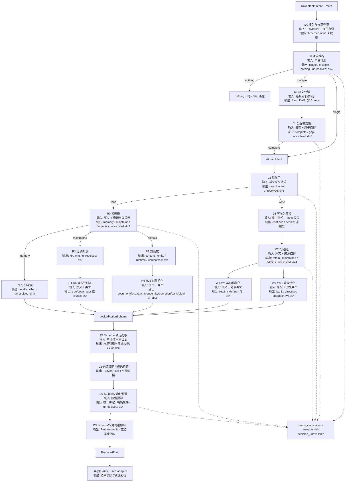
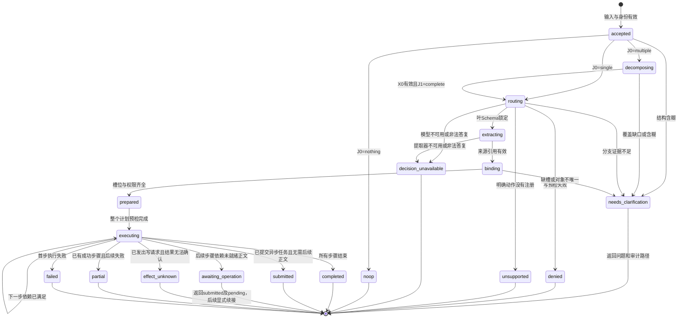

# 分层 Judge：决策拓扑与执行合同

`hindsight(intent: string, meta?: Record<string, unknown>)` 保持唯一工具入口。插件把自然语言转换为有类型、有来源证据的动作计划。Choice Judge 负责有限分类，结构化提取器负责定位原文，确定性代码负责参数装配、权限检查与执行。

本目录采用 `chinese-writing-standard` 与 `writing-style` 的中文技术写作规范。设计依据包括本仓库 `ARCHITECTURE.md`、`RUNTIME.md`、`ssot/spec.ts`，以及 onlyne 本地源码中的 `ChoiceQuestion`、`JudgeDecider.#judge`、`fitState` 与 `judgeRecord`。onlyne 的实际问题有超过 4 个选项的实例。本设计复用其调用协议与证据式 criteria，并单独限制分支度。

## 目录与事实源

- [nodes.md](nodes.md)：每个 Choice 节点的问题、可见字段、criteria 与转移。
- [types.md](types.md)：从 `RawIntent` 到 `ResolvedAction` 的 TypeScript 合同。
- [slots.md](slots.md)：无损来源绑定、提取器、bank 与对象解析。
- [execution.md](execution.md)：复合意图、失败状态、审计与重放。
- [ssot.md](ssot.md)：节点注册类型、分区检查、信息隔离与分层误差边界。

本目录是设计规范。当前运行代码尚未实现这些节点。实现时，节点表、动作 Schema、上下文投影、额度与状态迁移进入 `ssot/spec.ts` 的对应切片。运行时和生成文档从这些切片派生，手写文档保留推导与例子。

## 为什么按这些维度拆分

设支持的叶动作集合为 $A$。单次从 $A$ 中选择混合了四类问题：请求产生什么副作用、答案属于哪个信息通道、目标对象是什么、API 需要什么参数。分类错误会把下层问题带入上层。例如，“查看知识页”与“删除知识页”共享对象词，副作用完全不同。

每个节点 $n$ 有当前阶段的解释域 $\Omega_n$、候选域 $C_n\subseteq\Omega_n$、投影 $P_n$ 和语义分区 $C_{n,1},\ldots,C_{n,k}$。动作路由的解释域是叶动作集合 $A$；请求结构节点的解释域是计划形态；目标与属性节点的解释域是当前候选对象或属性值。自由文本参数不进入 Choice 候选域。普通分支满足：

$$
C_{n,i}\cap C_{n,j}=\varnothing\quad(i\ne j),\qquad
\bigcup_i C_{n,i}=C_n.
$$

每个语义节点最多有 3 个普通分支，另有 `unresolved`。因此每题的总分支度满足 $2\le d(n)\le4$。`unresolved` 表示证据不足、证据冲突或请求落在已支持候选之外，它直接结束当前解析。任何节点都没有“其他操作”这个会继续猜测的分支。

上述集合是工程定义。自然语言含义仍由模型判定。集合互斥、低分支度和有来源参数共同约束错误范围，它们无法证明模型必然理解正确。模型的有效答案属于协议合法性证据，语义正确性需要与原始请求核对。

分区顺序依据执行所需的前置事实：

1. **请求结构**：区分一个动作、多个动作、明确无动作。多动作先形成保留原文的计划。
2. **副作用**：读与写先分开。子代理写请求在获取写参数和写正文之前阻断。
3. **信息通道**：读分为记忆推理、已维护知识、具体对象与运维。写分为 retain、知识结构维护、管理。
4. **动作形态**：在已锁定的对象族内选择具体叶动作。
5. **范围与属性**：确定 bank、目标对象、过滤条件、预算和来源绑定。

“元运维”不是独立副作用类别。查看任务状态是读，取消远端任务是写。把它们同时放进“读／写／元运维”会破坏互斥性。

已知 internal path 由路径解析器直接限定候选域。模型仍判断调用要求的副作用。`meta.target` 指向一篇知识页，不代表它要求读取还是删除。

## 拓扑

方框标注输入、输出与分支度。`J` 是 Choice 节点，`D` 是确定性变换，`X` 是结构化提取器。图中 `U` 收集所有 `unresolved` 转移。实际候选只有节点表列出的选项。

节点深度由信息依赖决定。多个独立原子请求可分别解析。单个原子请求的前后节点依次执行。只把依赖同一固定投影的独立属性问题放进一次 `judge.judge({ state, questions })`。问题集合包含前置答案未知的节点时，需要拆成后续调用。

bank 选择可产生任意数量候选，它无法直接变成一题。先执行确定性 ID／alias／配置默认值匹配。语义候选超过 3 个时，只返回消歧列表。系统不把库随意分成甲、乙两组询问模型，避免用不稳定的人造分组替代语义证据。

## 形式化状态机

一次解析的状态为

$$
S=(r,G,i,n,C,B,E,L,q),
$$

其中 $r$ 是不可变原始请求，$G$ 是原子动作 DAG，$i$ 是当前原子动作，$n$ 是当前节点，$C$ 是剩余动作候选，$B$ 是已绑定槽位，$E$ 是来源证据，$L$ 是有序审计事件，$q$ 是生命周期状态。

转移函数为 $\delta(S,o)$。输入 $o$ 为校验后的模型答复、目录响应或宿主事件。确定性代码执行转移。模型答复进入审计后，离线重放使用同一答复。

新信息通过下一次 `hindsight` 调用传入。`meta.resume` 指向原审计资源，创建新的 request ID，并保留 `parentRequestId`。上一请求保持不可变。续接重新检查身份、权限、配置版本与未执行动作，防止使用过期许可。

## 必须保持的不变量

| 不变量 | 实施位置 |
|---|---|
| 每个 Choice 节点总选项数为 2～4，包含 `unresolved` | 节点注册与构建期校验 |
| 叶动作的 read/write 取自动作 Schema | 动作注册表与执行准入 |
| 写动作只在主会话且目标权限允许时执行 | 路由预检和 executor 的同一纯权限函数 |
| 子代理不能通过 meta、路径或结果依赖提升权限 | 宿主身份单独保存，meta 无身份字段 |
| 每个业务参数均有显式来源、命名配置默认值或已声明结果依赖 | 槽位验证 |
| 大正文保持原始顺序、字节和引用关系 | 来源仓库与物化层 |
| 计划中的每个被要求动作都有原文依据 | 分解覆盖检查 |
| 当前节点看不到白名单外字段 | 投影构造器 |
| API 操作、取消、缺槽与拒绝均有持久路径 | 审计入口与结果存储 |
| 模型失败不会触发猜测动作 | 调度器 |
| 执行前全部步骤完成静态预检 | 计划执行器 |
| 模型决策日志可重放，模型重跑不承诺相同输出 | 审计与重放模式 |

## 与现有 SSOT 的接合

分层判定的题树已经落进 SSOT：`JUDGE_QUESTIONS` 现在是 `docs/02-judge-system/02-choice-nodes.md` 的 J/R/W/S 系列，每题 2–4 个选项，节点之间的边由每项的 `when`（上一问必须取到哪些答案）表达。没有单独的 `JUDGE_NODES` 表——题与边都在这一个数组里，避免第二份判定来源。

顶层不再把 11 个操作名摊成一道题：`j0` 判复合性、`j2` 判读/写，此后沿 R 系列（只读细分）或 W 系列（写入细分）下行到叶动作，`s0` 负责 bank 消歧。原先的 `budget` 不再由题库问，改为从 `meta.slots.budget` 取、缺省 `mid`；`kbop`/`mmop`/`writesummary` 被 R4/W3/W4/W5/W1 取代。

`OPERATIONS.kb/mm/bank.write=true` 只能描述粗操作族。新 `ACTION_SCHEMAS` 按叶动作记录 `effect`，例如 `kb.get=read`、`kb.node.delete=write`。兼容层会重建第二套判定来源，因此现有调用方需要同时切换。

`reflect` 的综合答案、搜索结果列表与失败详情拥有完整快照路径。事实引用只是快照中的资源链接。现有 `hindsight://plugin/operations/{seq}` 可以承载完整请求、节点日志和结果。新增子路径登记到 `PATH_ROUTES` 后再由工具返回。

`RUNTIME.md` 的“1 次 judge”、截断 `query=intent`、默认根据“我们怎么做”优先选 kb，以及“context 一句话由 choice 生成”需要同步替换。新的边界是：路由需要多次低分支决策，正文按来源绑定，语义上的检索范围保持完整，已维护知识通道需要明确资源证据。

本设计没有增加自动 recall、自动 retain 的触发时机。已有运行时钩子可直接提交已知动作及权威来源。它们需要语义判定时，复用局部节点与提取合同，不重新进入通用工具路由。

## 来源

- `hindsight-omp/ARCHITECTURE.md`：既有模块边界、审计路径、执行入口。
- `hindsight-omp/ssot/spec.ts`：现有操作、路径与平面问题定义。
- `project-research-for-reference/02-api-surface.md`：当前记录的 API 端点与资源对象。
- `project-research-for-reference/07-v1.1-verification.md`：官方 1.1 的文档、块、附件与异步写入实测。
- `/Users/dbydd/vibe-agent-working-dir/git-projects/onlyne/packages/omp-onlyne/src/decider.ts`：`ChoiceQuestion`、`resolveJudge` 调用、`fitState`、`judgeRecord`。
- `/Users/dbydd/vibe-agent-working-dir/git-projects/onlyne/packages/omp-onlyne/src/decider-text.ts`：证据式 criteria 与明确消歧出口。
- `/Users/dbydd/manual_install_pkgs/pi-hindsight/extensions/decision/host.ts`：omp `completeSimple` 生成端口的既有适配。
- `/Users/dbydd/manual_install_pkgs/hindsight/hindsight-clients/python/hindsight_client_api/`：对象请求字段和远端任务取消／重试的生成客户端。

API adapter 的 HTTP 方法、请求字段和 `required` 集合从官方 1.1 的 OpenAPI 固定版本生成。上述本地研究包含现役修改版的端点记录，不能直接充当 1.1 请求 Schema。设计文档中的语义槽位名与 HTTP 字段分开，adapter 负责一一映射。
