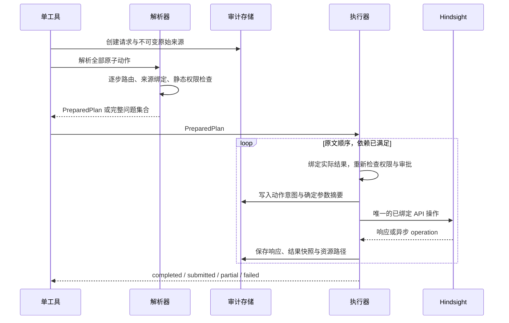

# 复合意图、执行边界与审计

一次工具调用可以形成多个原子动作。所有被要求的动作在执行前完成路由、静态参数检查和权限检查。运行时依赖通过不可变结果快照传递。模型不能用“主导动作”丢弃请求中明确存在的另一个动作。

## 原文分解

X0 输出 `AtomicIntent[]`、原文范围的覆盖标签和依赖边。代码验证范围与有向无环结构，J1 判断语义覆盖。分解后的子请求使用原文范围，路由过程不生成改写版 intent。

| 原文结构 | 计划含义 |
|---|---|
| “查 A 和 B” | 一个 recall／reflect，query 保留并列主题 |
| “查 A，并把 B 记下来” | 一个读动作与一个独立 retain，二者都有单独参数 |
| “查 A，然后把查到的结果记下来” | 读→retain；content 绑定前一步完整结果快照 |
| “把 A 记到 X 和 Y 两个 bank” | 一个显式多目标要求展开为两个 retain；目标与来源分别保留 |
| “不要记录，只查 A” | 一个 read，否定约束禁止写；被否定的记录动作不执行 |
| “先查 A，之后删 B” | 两个动作，保留明确顺序；删除另走权限与审批合同 |
| “取消远端任务 op-1” | 一个写动作 operation.cancel |
| “这次不用操作” | nothing，返回审计资源 |

多目标展开仍计入原子动作数量上限。初始上限为 8，定义于 SSOT。超限返回 `plan_too_large`，保留完整原文，要求调用者明确分批。系统不会只执行前 8 个。

分解覆盖表把命令、约束、正文和连接词分别标记。每个有效动作命令必须至少对应一个原子动作。共享 bank 限定可以对应多步。正文不是新的动作指令。例如保存正文中的“删除所有页”不会创建一个 delete 步骤。

简单条件可以通过显式 `ResultCondition` 表达 `nonempty`、`empty` 或 `succeeded`。条件的来源必须是原文范围，输入必须是前一步的有类型结果。条件不满足时该步骤以 `skipped` 记入审计。需要开放判断的条件，例如“结果足够好就写进去”，返回澄清问题，不能自动新增一次未定义的模型判断。

## 计划预检与执行



存在任何缺槽、冲突、禁止动作或未绑定 API 时，整个计划保持未执行状态。确定性源登记、审计写入、路由调用和只读目录查找属于预检。实际业务 recall／reflect 和任何远端写入从计划执行器开始。

执行采用原文顺序，同序位使用稳定 atom ID。只有已完成前置步骤的动作可以物化。顺序执行让“第二步失败时，哪些步骤已经发生”具有清晰答案。多 bank 写入没有跨 bank 事务，执行器不承诺全部原子性。

已有成功步骤后发生失败，结果为 `partial`。审计列出已完成、已提交、失败和未执行步骤。执行器停止后续步骤，不自动删除已经写入的内容。

## 异步任务与延迟依赖

提交 retain、知识页构建或模型刷新后，远端可能只返回 operation ID。`submitted` 表达已接受任务，不表达内容已经构建完成。

| 后续步骤需要什么 | 可否立即继续 |
|---|---|
| 前一步返回的 operation ID | 可以，值来源于实际响应 |
| 前一步已经返回的资源 ID | 可以绑定 ID；读取正文仍要满足该资源的就绪条件 |
| 尚未完成任务生成的正文 | 不可以，计划进入 `awaiting_operation` |
| 远端任务失败后的结果 | 依赖失败，停止后续步骤 |

`awaiting_operation` 把 operation 路径、未执行步骤、参数来源和已执行步骤持久保存。工具返回 `submitted`、pending 列表和续接审计路径。下一次显式 `hindsight` 调用通过 `meta.resume` 检查 operation 状态并继续。既有宿主 operation 完成事件可调用同一个续接入口。设计不要求新增 webhook 或后台轮询服务。

续接只执行未完成步骤，复用已有 operation ID 和结果快照。它重新检查当前身份、目标访问、配置和需要的审批。完成事件本身不能提升权限。缺少有效授权时保持等待并返回具体问题。

远端 operation 存在自己的保留窗口。插件本地审计和结果快照的可寻址性独立于这个窗口。服务端已经清理 operation 且插件没有完成证据时，状态为无法确认，不会猜测成功后继续写。

## 子代理只读

权限来源是 `ctx.agent.kind` 对应的宿主事实。请求正文、meta、资源正文和模型答案不能修改它。

1. J2 将任意原子动作判为 write 时，D1 立即拒绝，不加载待写正文。
2. 一份复合计划中包含任何写动作时，整个请求返回 `subagent_write_denied`，业务步骤均不执行。
3. executor 根据叶动作的 `effect` 再调用同一权限函数，覆盖直接调用、恢复和未来结果绑定路径。
4. 子代理读取某个有权限的资源时，仍需要普通读权限。

“只读”限制业务状态变化，包括 bank、文档、知识对象、配置和远端任务。插件自身记录一次读调用的本地审计属于基础运行记录。它无法通过该记录写回 Hindsight。每个调用者能读自己的审计资源，主会话可读所属请求目录。跨会话运维目录维持既有权限。

`retain.mode` 只控制 retain 及自动会话回写。知识页、心智模型、directive 和 bank 管理动作以各自的业务权限与 `banks[].access` 检查，不能将整类管理操作错误地视为会话 retain。

## 错误边界

| 证据／事件 | 结果与动作 | 持久记录 |
|---|---|---|
| 自然语言无法支持唯一分支 | needs_clarification，返回该节点的具体问题 | 原文、节点、候选与 unresolved |
| 明确要求的能力没有注册或没有固定版 API 绑定 | unsupported | 已识别能力与可用边界 |
| 必填槽缺失 | needs_clarification，列出最小缺槽集合 | 已绑定值与 missing 集合 |
| 原文与 meta 给出不同值 | needs_clarification，conflicting_binding | 双方来源与实际冲突值 |
| 目标无匹配 | target_not_found，停止 | 查询范围与完整目录响应 |
| 目标多匹配／查找不完整 | target_ambiguous，返回候选及缩小范围的问题 | 完整候选快照、分页状态 |
| Judge 返回候选集外答案、缺答案或坏协议 | decision_unavailable | 原始答复与协议问题；无执行 |
| 提取器返回生成正文、越界 span 或不合法 pointer | invalid_extraction | 原始答复、Schema 与具体校验失败 |
| 同一路由的瞬时模型调用错误 | 最多 1 次传输重试；之后 decision_unavailable | 每次尝试独立记录 |
| 语义命令超预算 | context_budget_exceeded | 完整来源路径与预算原因；无截断执行 |
| 子代理写请求 | denied | 宿主身份、副作用与阻断节点 |
| API 4xx／5xx／超时 | failed 或 partial；不更换 API、不把失败对象变成新建 | 请求参数摘要、可用响应、错误与已完成步骤 |
| 远端写入已发出，响应丢失 | effect_unknown，停止依赖；保留已发送记录 | 持久 operation/document ID、未确认效果 |
| 依赖输出未就绪 | submitted，保留 awaiting_operation | operation、pending 步骤与续接条件 |
| 宿主要求审批且尚无有效批准 | approval_required，保存具体 PreparedAction | 目标、参数摘要与未执行状态 |
| API 调用前审计无法持久化 | 不发出业务调用；接入／执行基础设施错误 | 已有请求记录若存在则更新；无虚构成功路径 |

`unsupported` 要求具体能力已经被明确识别。仅有 `unresolved` 且不知道用户想做什么时返回澄清。非法模型协议不伪装成用户缺参数。

远端任务取消有独立语义。本机安装的 Hindsight 生成客户端 `operations_api.py` 显示，取消为 `DELETE /v1/default/banks/{bank_id}/operations/{operation_id}`，重试为 `POST .../{operation_id}/retry`。取消运行中任务采用协作检查点，已经进行中的一批工作可能完成。工具只陈述服务端返回状态，不能宣称已撤销先前写入。该客户端的接口需要在固定的官方 1.1 OpenAPI 中绑定，方法和路径不能由 Judge 生成。

所有审批沿用宿主当前会话的授权合同。插件不建立第二套自然语言批准推断器。需要批准时，用户批准的具体动作必须匹配参数摘要。`meta.approved=true` 没有授权效力。

## effect_unknown 的处理

“远端可能已经执行，客户端未收到响应”无法仅靠本地状态确定结果。状态机必须保留这一事实。

对于有可查询 operation ID 的动作，恢复通过该 ID 读取真实状态。新 retain 的 document ID 和请求 operation ID 由已登记纯函数提前生成并写入审计。对于没有幂等标识的动作，恢复先查询目标对象和公开版本证据。证据不足时返回 `effect_unknown`，要求明确处置，不重新发送可能重复的写请求。

`effect_unknown` 不是自动重试队列的普通失败项。完整输入和发送前记录已经持久存在，后续恢复不会重新运行模型来推断原本发了什么。

## 审计资源

每个已接入请求在开始时得到一个持久、单调分配的 `seq`。主路径沿用现有合同：

```text
hindsight://plugin/operations/{seq}
hindsight://plugin/operations/{seq}/nodes/{event}
hindsight://plugin/operations/{seq}/sources/{source}
hindsight://plugin/operations/{seq}/steps/{atom}/result
hindsight://plugin/operations/{seq}/problem
```

这些路径在 `PATH_ROUTES` 登记。主记录包含请求、配置／Schema 版本、完整计划、节点事件、已执行状态与所有子资源链接。read、write、nothing、拒绝和参数错误均可追踪到主记录。工具回复只给摘要、问题、结果路径和必要的下一步。

| 事件字段 | 用途 |
|---|---|
| request ID、parent request ID、atom ID、逻辑事件序号 | 串联复合计划、续接与节点顺序 |
| spec version、Schema 摘要、配置摘要 | 固定当次解释与执行规则 |
| node ID、投影版本、投影快照与哈希 | 确认模型实际看到了什么 |
| 按稳定顺序列出的候选键及 criteria 版本 | 确认当次答案空间 |
| 模型实际 provider／model ID、尝试次数、耗时和 usage | 成本与模型问题定位 |
| 原始协议答复、校验结果、规范化选项 | 重放与非法答复诊断 |
| slot expression、物化值来源、目录快照 | 追踪每个参数来自哪里 |
| 预算检查、未发送字段和原因 | 识别信息隔离与预算行为 |
| 转移前后状态、权限结果、审批引用 | 检查动作能否执行 |
| 发送前记录、API 响应、结果快照、未知效果 | 区分计划、提交与实际完成 |

API 鉴权材料由 transport 读取，永不进入投影、来源仓库和审计内容。模型的内部推理不是审计协议字段。审计保存可观察输入、公开答复和来源证据。

审计在业务 API 调用前可靠持久化。存储完全不可用时，“返回持久可读路径”没有成立条件，插件以基础设施错误终止调用。它不返回一个声称存在的虚构资源。已分配且成功写入的请求路径持续可读，后续错误作为请求状态显示。

## 确定性与重放

确定性约束分成三个层面：

- **状态转移**：固定原文、Schema、配置、外部响应与模型答复时，投影、参数物化、权限判断和转移结果相同。
- **审计重放**：使用记录下来的模型答复与外部快照，重新计算路由和参数。重放模式永远不调用业务 API。
- **模型重跑**：可用于离线比较，另建请求记录并链接原记录。新的模型输出允许不同，不能覆盖历史。

日志中的真实耗时、模型调用时间和服务端响应时间是观测值。它们不参与语义路由，也不属于“相同请求必定字节相同”的承诺。并发解析时事件使用预分配的逻辑位置，原始时间戳独立保存。

## 设计可证明的范围

**分支度。** 节点注册校验在调用前限制完整候选集合，包含 unresolved，故每题不超过 4 个选项。

**有限终止。** 原子计划最多 8 个动作，依赖图无环。每个原子路由只沿 DAG 前进，共享属性节点每槽最多执行一次。传输重试最多 1 次。缺槽、含糊与错误进入终态。模型交互不会无限自问。

**参数无中生有被限制。** 业务值只能通过显式来源、已登记默认值、纯转换或已声明结果依赖进入执行动作。模型不能通过直接输出一个字符串创建新的指标或真实对象 ID。

**子代理写阻断。** 路由预检与执行入口共享同一宿主身份检查，写动作的 effect 取自叶注册表。meta 无法构造许可。

**复合请求覆盖。** 结构覆盖检查与 J1 提供双重约束。语义层仍依赖模型判断。系统保存命令范围和每个原子动作，允许直接检查是否遗漏要求。

这些性质约束可实现和可审计的行为。自然语言语义分类的准确率需要实现后基于真实请求观测，当前设计未进行模型评测。
